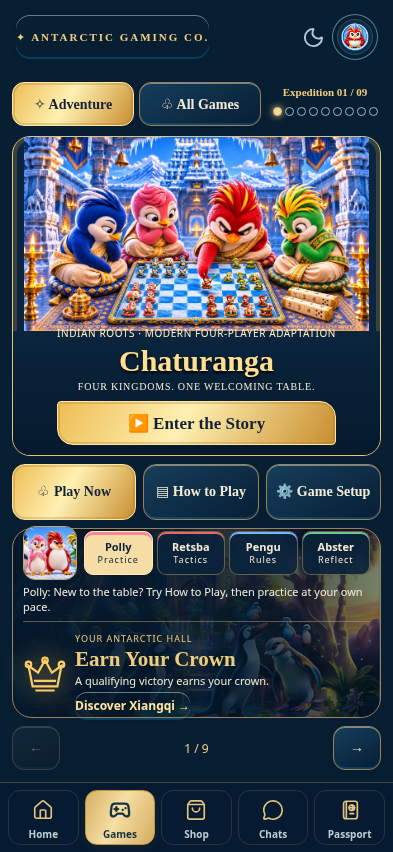
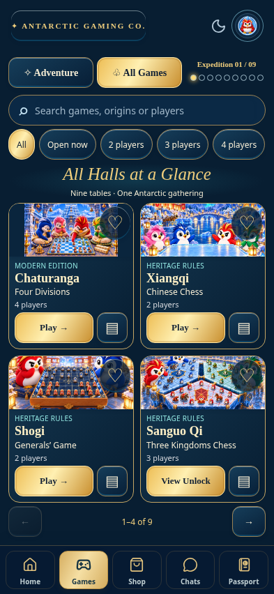

# Chaturanga Games artwork and hosts

Reviewed main: `f696f57637ec8a1433bcaeafcd0ebc494fcba96b` (PR #119 merge).
Branch: `codex/chaturanga-art-mascot-layout`.

## Accepted layout

The three images supplied on 25 November 2026 govern this change. The four-host icy temple/table image is the Chaturanga Adventure hero and its All Games thumbnail. `object-fit: contain` keeps all four hosts and the board visible. The garden illustration backs the crown panel. The supplied mascot group accompanies four real guide buttons. Their tips cover practice, tactics, rules and reflection; the existing How to Play and setup callbacks remain authoritative.

This task’s explicit names are Polly (pink), Retsba (red), Pengu (blue), and Abster (green). The repository’s `PENGUIN_HOSTS_DIRECTION.md` and `PenguinHosts.jsx` currently use Nova/Rocco/Piko/Ziggy. This conflict is recorded rather than rewriting names across the application. The supplied plush images govern this page; the older flat project attachments are not substituted. Existing IDs, save formats, board pieces and native heritage roles are retained.

The cover is an illustration, not an instruction diagram or a historical reconstruction. The hero labels the chosen edition a modern four-player adaptation. Existing sourced story screens and rules are retained.

## Runtime and packaging

The approved v5.10.2 APK is reconstructed from the repository’s checked download parts and verified against SHA-256 `275cf9bf69aadfa4f4d844ff412e0885d8a5a656539f4bb583af27bfc95e8ecd`. The original `app.js` is checksum guarded and parsed before the existing `GamesAdventure` presentation declaration is replaced. The later `App.jsx`/`GamesViews.jsx` source is not the render authority for that APK and is not rebuilt here. Backend bootstrap, transformations, authentication, wallets, engines, workers, match validation, Home and loading remain outside this change.

New art is stored separately under `frontend/public/assets/launch-v1/chaturanga-games/`; original artwork is not overwritten. `artwork.json` records source names and original/optimized hashes. The patch verifies new artwork hashes, copies the three files, and records their output hashes. The Android review packager adds these files to its asset manifest while retaining its six-entry original-payload change guard and original-signature requirement. No key is included. No signed APK or production deployment was created in this task.

## Verification

- Full retained-runtime DOM regression: 10 groups pass, including all four guide selections, nine stories, setup/team choices, unlock callbacks, crown validation, catalogue reachability, keyboard and swipe navigation.
- Existing heritage introduction suite: one pass, one optional external-runtime case skipped.
- Chromium renders at 360×800, 393×852, and 393×960 in both themes: primary actions visible without page scroll; catalogue paging, search, player filters, favorite persistence and 24px root-text fallback checked. Home pixels are compared to the original runtime.
- JavaScript/Python syntax and `git diff --check` pass.

See `results.json` for exact render results. Screenshots use isolated fixture accounts and mocked network responses, never real registrations, victories or mints. Physical Android installation, TalkBack, live Para authentication and multiplayer acceptance were not tested here.

Reproduce:

```sh
npm ci --ignore-scripts --no-audit --no-fund --prefix mobile/arctic-play/build-deps
python3 mobile/arctic-play/scripts/prepare-storybook-review.py
node mobile/arctic-play/tests/storybook-runtime.mjs storybook-review/after/app.js
# PLAYWRIGHT_PACKAGE points to a package.json whose dependencies include playwright and pngjs.
PLAYWRIGHT_PACKAGE=/path/to/browser-review/package.json CHROME_BIN=/path/to/chromium node mobile/arctic-play/tests/storybook-browser.mjs
```



